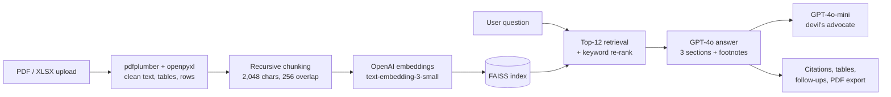

# 🏦 Bank Annual Report Analyst

**A RAG chatbot that answers finance questions across UK bank annual reports, with page-level citations and a built-in "devil's advocate" critique of every answer.**

Ask *"Compare NatWest and Lloyds' CET1 capital ratios"* and get an executive-style answer: the key insight first, then the drivers, risks and opportunities, then footnoted sources that point to the exact document and page. A second model then challenges the answer, so analysts see both the case and its weak spots.

Built during a NatWest hackathon to give finance teams one consistent way to benchmark competitors from public filings.

---

## ✨ Features

| Feature | What it does |
|---|---|
| **Multi-format ingestion** | Upload annual reports and Pillar 3 disclosures (PDF) and financial supplements (XLSX/XLS) straight from the sidebar |
| **Table-aware PDF parsing** | `pdfplumber` extracts text and tables per page, strips headers, footers and page numbers, and tags Basel III table codes (CR1, OV1, …) |
| **Spreadsheet rows as text** | Each XLSX data row becomes a natural-language sentence (bank, year, tab, metric) so numbers can be retrieved semantically |
| **Retrieval + re-ranking** | FAISS similarity search returns the top 12 chunks, re-ranked by keyword overlap with the question |
| **Cited answers** | GPT-4o answers in three fixed sections, with `[^n]` footnotes linked to source document and page |
| **Devil's advocate** | A second model (GPT-4o-mini) acts as a sceptical risk officer and flags assumptions, data gaps and alternative readings |
| **Dual-bank coverage** | The system prompt always reports the equivalent metric for each bank, so answers are comparable |
| **On-demand comparison tables** | Turns the figures in an answer into a clean side-by-side table |
| **Conversation memory** | Keeps the last 3 exchanges as context for follow-up questions |
| **Suggested follow-ups** | Proposes next questions after each answer |
| **PDF export** | Downloads any answer (insight, detail, table, critique, sources) as a formatted PDF report |
| **Editable analyst persona** | The system prompt can be edited and reset live from the sidebar |

---

## 🧭 How it works



### Answer format

Every answer follows the same structure, set in [`prompts/system_prompt.md`](prompts/system_prompt.md):

1. **Final condensed insight**: 2–5 actionable bullets that answer the question.
2. **Supporting detail and rationale**: drivers, trends, forward assumptions, risks and opportunities.
3. **Sources, evidence, assumptions and caveats**: footnoted evidence and any stated assumptions.

Figures follow UK banking conventions: £bn to one decimal place for balances and RWAs, £m for income, and bps for margins.

---

## 🛠️ Tech stack

- **LLMs:** OpenAI GPT-4o (answers), GPT-4o-mini (critique)
- **Retrieval:** LangChain, FAISS, OpenAI `text-embedding-3-small`
- **Parsing:** pdfplumber, openpyxl, pandas
- **App:** Streamlit
- **Export:** ReportLab

---

## 📁 Project structure

```
├── app.py                  # Streamlit UI: upload, chat, citations, tables, critique, PDF export
├── rag_backend.py          # Retrieval, re-ranking, prompting, devil's advocate, follow-ups
├── pipeline.py             # PDF/XLSX parsing, chunking, embeddings, FAISS index (also a CLI)
├── prompts/
│   ├── system_prompt.md    # Executive analyst persona and answer format
│   └── Challenger prompt.txt  # Reviewer prompt for scoring answers (0–100%)
├── requirements.txt
└── .env.example
```

---

## 🚀 Getting started

### 1. Install

```bash
git clone https://github.com/varunchander1/<repo-name>.git
cd <repo-name>
python -m venv venv
source venv/bin/activate        # Windows: venv\Scripts\activate
pip install -r requirements.txt
```

### 2. Add your OpenAI key

Copy `.env.example` to `.env` in the folder you run the app from, and add your key:

```
OPENAI_API_KEY=sk-...
```

> **Tip:** `python-dotenv` looks for `.env` in the current working directory. If the key isn't picked up, run `python -c "import os; print(os.getcwd())"` and place `.env` there.

### 3. Run the app

```bash
streamlit run app.py
```

Upload one or more reports in the sidebar, wait for ingestion, then ask a question.

### Optional: build the index from the command line

```bash
python pipeline.py --pdfs natwest_annual_report.pdf lloyds_annual_results.pdf \
                   --xls natwest_financial_supplement.xlsx lloyds_financial_supplement.xlsx
```

---

## 💬 Example questions

- *Compare NatWest and Lloyds' CET1 capital ratios*
- *What are the central bank cash levels at NatWest and Lloyds, and what trends do they imply?*
- *How did NIM change year-over-year for Lloyds?*
- *Compare the cost-to-income ratios of both banks*
- *What are each bank's stated strategic priorities?*

### Tested with

2025 annual reports, Pillar 3 disclosures and financial supplements from **NatWest, Lloyds, Barclays UK, HSBC UK and Nationwide**: 12 public filings in all. The filings are not included in this repo; download them from each bank's investor relations site.

---

## ⚠️ Limitations

- Re-ranking uses simple keyword overlap; a cross-encoder would rank more precisely.
- Answers are only as good as the retrieved chunks. Always check figures against the cited pages before relying on them.
- Uses only public filings. It is an analysis aid, not financial advice.

---

## 👤 Author

**Varun Chander**, AI Engineer, Gen AI and Agentic AI
[GitHub](https://github.com/varunchander1)
